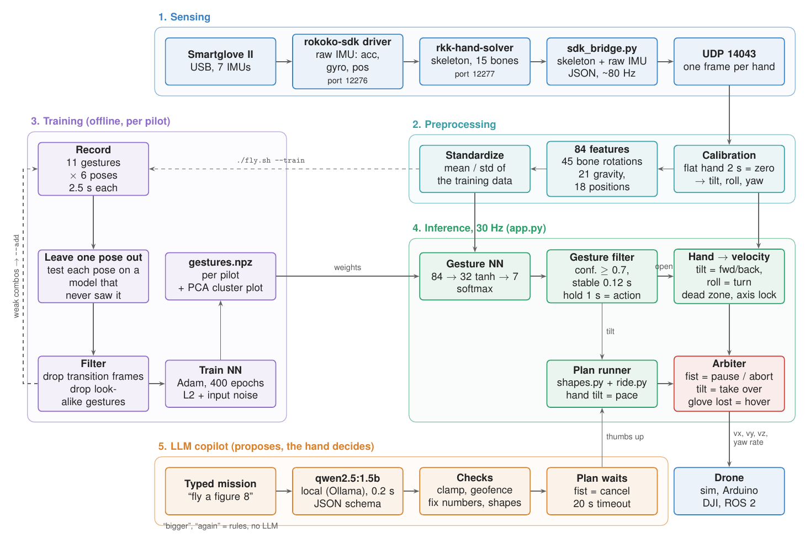

# SkyHand

Fly a drone with a Rokoko Smartglove. The hand flies the drone directly. A small local LLM turns a typed
mission into a plan, and the hand approves it, pauses it or takes over.

Junction 2026, Rokoko Robot Teleoperation Challenge. Flies a real drone over MQTT, with optional cloud VLM
obstacle avoidance. New machine (Mac or Linux): see [MAC_SETUP.md](MAC_SETUP.md).

## Run

```bash
./setup_venv.sh         # once: creates .venv (fly.sh uses it automatically)
./fly.sh                # REAL DRONE: flight window with hand cards, MQTT to 192.168.4.2 (--mqtt-host, --dry-run)
./fly.sh --ai           # same + VLM obstacle avoidance (drone runs scripts/ai_mux.py, cloud runs scripts/vlm_service.py)
./fly.sh --sim          # simulator with 3D view, no drone
./fly.sh --fake         # simulator, no glove
./fly.sh --train        # record your gestures and train the NN (Linux / Device SDK)
python3 -m pytest -q    # tests
```

Flight window gestures (right hand, palm down): thumbs up 1 s = take off, open hand tilt = forward/back,
peace + roll = turn, index pointed up/down = up/down a bit, fist or pinky 1 s = land, Esc = land.

## Pipeline



Source: [docs/pipeline.tex](docs/pipeline.tex) (TikZ). Rebuild: `tectonic docs/pipeline.tex && pdftoppm -png -r 150 -singlefile docs/pipeline.pdf docs/pipeline`.

Text version:

```
Smartglove II (USB)
  -> rokoko-sdk driver     raw IMU per sensor: acc, gyro, position          port 12276
  -> rkk-hand-solver       hand skeleton: bone rotations                    port 12277
  -> scripts/sdk_bridge.py skeleton + raw IMU as JSON, ~80 Hz per hand      UDP 14043
  -> skyhand/app.py        30 Hz loop:
        calibration + features -> gesture NN -> gesture filter -> motion mapping -> velocity cmd -> sim
                                                  ^
        typed mission -> LLM -> plan check -> waits for thumbs up -> plan runner
```

## 1. Preprocessing

- Calibration: the flat hand held for 2 s is the zero pose. Tilt, roll and turn are measured relative to it.
  `c` in the terminal recalibrates.
- NN input, 84 numbers per frame:

  | Part | Size | What |
  |---|---|---|
  | finger bones | 45 | 15 bones x rotation relative to the parent bone. Same value whatever way the hand faces |
  | gravity per sensor | 21 | 7 sensors (hub, arm, 5 fingers), accelerometer normalized to a direction |
  | finger sensor positions | 18 | 6 sensors relative to the hub, in dm. Comes from the IMU, not the solver |

- Each feature is standardized with the mean/std of the training data.

## 2. Gesture NN

- Small numpy net: 84 -> 32 tanh -> softmax over 7 shapes. Adam, 400 epochs, L2, plus noise on the
  inputs during training so it copes with sensor jitter. Per pilot, no pretrained model.
- Data: `./fly.sh --train`, see "Collecting data" below. Current set: 1248 frames, 7 shapes, 2 rounds.
  Trained on round 1, tested on round 2: 100%.
- Runtime: confidence below 0.7 = no gesture = hover. A shape must be stable for 0.12 s to count,
  and held 1 s to trigger an action (take off, approve).
- Simple mode (default in sim) only uses the 4 shapes that are furthest apart in the data.
  Point, pinky and fist were too close to each other (about 4 vs 10+ for the others), so they are off.
- Other classifiers on the same data (other round as test): logistic regression 100%, SVM 100%,
  random forest 100%, kNN 100% but 22 ms/frame, gradient boosting 48%. The data is easy, so the model
  choice barely matters. More varied data matters more.
- PCA (SVD of the standardized features) is only used to plot the clusters. Not as a classifier, it
  only reduces dimensions. LDA, its supervised cousin, hit 100% but broke with noise.

Collecting data (`scripts/train_gestures.py`, `skyhand/gesture_select.py`):

| Flag | What you record |
|---|---|
| (none) | 11 candidate gestures x 6 hand poses, 2.5 s each, ~5 min |
| `--quick` | same, only the flat and tilt poses |
| `--add` | loads old data, asks only for weak or missing (pose, gesture) combos |
| `--gestures=open,fist` | only these |

- Poses: flat, tilt, on its side, palm up, arm high/low, arm moving. This catches a gesture that only
  works palm down.
- Candidates: the 7 above plus call (thumb + little), gun (thumb + index), three, and relax
  (loose hand). Relax is trained as "no command", so a resting hand doesn't trigger anything.
- After recording:
  1. Each pose is left out once and predicted by a model trained on the other poses.
  2. Frames that clearly look like another gesture are dropped (transitions), max 15% per gesture.
  3. Gestures that get mixed up more than 3% with a kept one are dropped. Open, fist, thumbs up and
     peace are always kept (the app needs them) and get a warning instead.
  4. The weak combos are printed, and `--add` asks for those next time.
  5. Cluster plot saved to `recordings/gesture_clusters_*.png`.
- Gestures the app has no action for (call, gun, three) are recognized, but give "no gesture" for now.

## 3. Hand -> drone

| Hand | Drone |
|---|---|
| open hand, tilt forward / back | fly forward / back. Full speed (1.5 m/s) at 35 deg, 15% dead zone |
| peace sign, roll right / left | turn right / left, up to 1 rad/s |
| fist | stop, hover |
| thumbs up 1 s | take off, or land when flying |

Only one motion at a time (axis lock). It frees up when the hand is flat again. Commands are smoothed.
Sideways and up/down are off in simple mode because they kept firing together with forward/turn.

Riding a shape (after a `path` plan is approved). The shape is exact, from code. The hand sets the pace:

| Hand | Drone |
|---|---|
| open hand, tilt forward / back | go along the shape / back along it, up to 1 m/s |
| flat hand | hold on the shape |
| peace sign, roll | shift the whole shape sideways |
| fist | pause (see 5) |

The drone faces the way the path goes. If it falls more than 0.6 m behind, the path waits for it.
In the sim it stays about 5 cm off the line on average (max ~0.2 m).

## 4. LLM copilot

- Model: `qwen2.5:1.5b` running locally in Ollama. No internet. About 0.2 s per answer.
- Input: the typed mission + drone state (flying or not, altitude). Typed in the box at the bottom of the
  sim window.
- Output: JSON plan using only known steps: take off, land, hover, move, turn, orbit, go where I point,
  go to waypoint, path (shape + size). Short prompt with examples, temperature 0, output forced to a JSON schema.
- Checks after the LLM: unknown steps dropped, moves clamped to 8 m, altitude to 5 m. If the LLM copies a
  number from the examples instead of yours, your number is put back.
- Edits like "bigger", "smaller", "again", "1 m higher", "other way" are done by plain rules on the last
  plan. The 1.5B model was bad at editing.
- If Ollama is down, a regex parser answers instead.
- Shapes: the LLM can't draw (asked for figure 8 / heart points it wrote circles), so it only picks a name
  from `skyhand/shapes.py`: circle, figure8, square, triangle, zigzag, spiral, heart. Size 0.5 to 6 m.
  If the text names a shape and the plan misses it, code puts it in (it wrote 4 moves for "square").
- Score on 20 test missions: qwen2.5:1.5b 20, llama3.2:1b 14, regex parser 14.

## 5. Human in the loop

| When | Hand | Result |
|---|---|---|
| plan proposed | thumbs up | fly it. Nothing moves before this |
| plan proposed | fist | cancel. No answer in 20 s = cancelled too |
| plan flying | fist | pause, hover, plan kept |
| paused | thumbs up | continue |
| paused | fist held 2 s | abort plan. Thumbs up then lands |
| plan flying | tilt open hand | plan stops, you fly (not during a shape, there tilt = pace) |
| glove lost | - | plan stops, hover |

The LLM never sends velocities. It only proposes, the hand decides.

## 6. Folder structure

```
glove-drone-teleop/
├── fly.sh                  starts driver/bridge (Linux) or uses Rokoko Studio (Mac), then the app
├── setup_venv.sh           creates .venv
├── MAC_SETUP.md            setup + run on a new machine
├── requirements.txt
├── skyhand/                main app
│   ├── app.py              30 Hz loop, approve / pause / abort logic
│   ├── rokoko.py           UDP receiver for glove frames
│   ├── sdk_convert.py      SDK skeleton -> our hand format
│   ├── sdk_raw.py          raw IMU parsing
│   ├── hand.py             calibration, tilt / roll / yaw, finger bend
│   ├── quat.py             quaternion helpers
│   ├── gesture_model.py    84 features + NN
│   ├── gesture_select.py   what to record, drop bad frames and look-alike gestures
│   ├── gestures.py         stable / hold filter
│   ├── mapping.py          hand -> velocity, dead zone, axis lock
│   ├── llm.py              LLM prompt, checks, edit rules, fallback parser
│   ├── planner.py          allowed steps, limits, plan runner
│   ├── shapes.py           shape library, exact points every 5 cm
│   ├── ride.py             hand-driven path follower
│   ├── sketch.py           air drawing (older feature)
│   ├── viz.py              sim window, mission box
│   ├── hand_icons.py       gesture icons in the window
│   ├── train_gui.py        window for gesture recording
│   ├── recorder.py         JSONL flight logs (--record)
│   ├── fake_glove.py       fake hand for --fake
│   ├── vlm.py              VLM client: obstacle check on a camera frame
│   ├── ai_mix.py           pilot + AI mixer rules (pilot always wins)
│   └── drones/             outputs: sim.py, mqtt.py, udp.py, ros2.py
├── scripts/
│   ├── sdk_bridge.py       Rokoko SDK -> UDP JSON, adds raw IMU
│   ├── train_gestures.py   record gestures + train the NN
│   ├── safe_fly_v2.py      the real-drone flight window (./fly.sh)
│   ├── safe_takeoff.py     MQTT link + colours used by the window
│   ├── ai_mux.py           runs on the drone: mixes glove + AI velocity
│   ├── vlm_service.py      runs in the cloud: camera stream -> VLM -> skyhand/ai_cmd
│   ├── vlm_avoid_check.py  VLM accuracy/latency check on scenes or photos
│   ├── glove_check.py      quick "is the glove streaming" check
│   └── fake_glove.py
├── models/gestures.npz     trained gesture NN
├── tests/                  pytest
├── docs/pipeline.tex/.pdf/.png  pipeline diagram (TikZ)
└── recordings/             gesture data + flight logs (not in git)
```

## 7. Demo

`./fly.sh --sim`, calibrate, thumbs up to take off, type `fly a figure 8` (or `heart`, `3 m spiral`,
`take off, square, then land`), thumbs up, tilt to drive it. Fist to pause, `bigger` / `again` to edit.

## 8. TODO

- [ ] Record the full sweep (`./fly.sh --train`), then `--add` until no weak spots are left.
- [ ] Record a second session on another day / after taking the glove off (fist already shifts between
      sessions, see the cluster plot).
- [ ] Record a second pilot and check how much a model from one pilot works for the other.
- [ ] Give call / gun / three an action if they survive the filter.
- [ ] Motion gestures (swipe, circle) need a model over time (GRU or 1D CNN in PyTorch).
