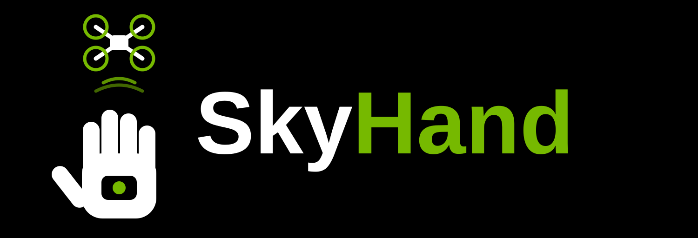
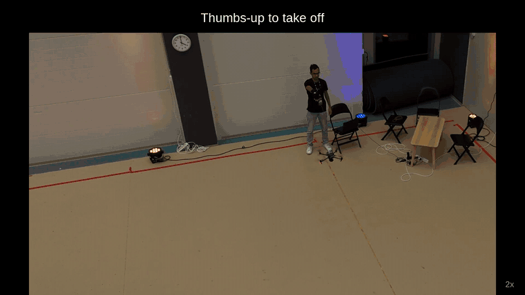
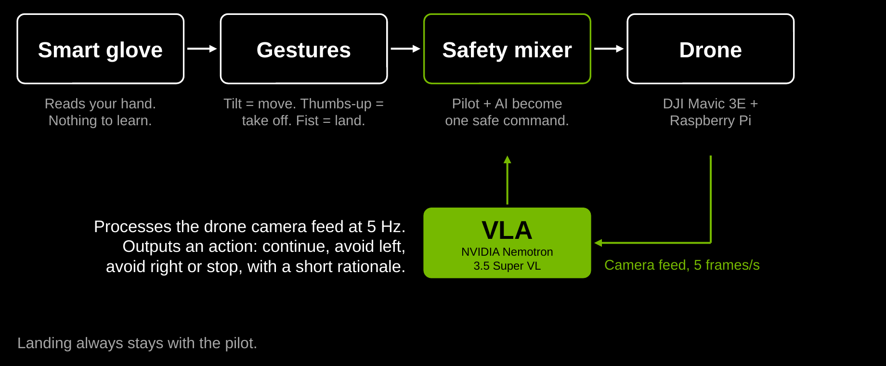

<p align="center"></p>

<h3 align="center">Fly a drone with your hand. AI keeps it safe.</h3>

<p align="center"></p>

## Quick start

```bash
git clone https://github.com/sehadnassim/SkyHand- skyhand && cd skyhand
./fly.sh --dry-run     # first run sets everything up; window opens, nothing is sent
./fly.sh               # fly the real drone
./fly.sh --ai          # + obstacle avoidance
```

Other modes: `--sim` (no drone), `--fake` (no glove), `--train` (record your gestures), `--check` (test the glove).
`./fly.sh --help` lists every option.

Hold your hand **flat, palm down, fingers forward for 2 s** to calibrate. Keep the DJI remote as the emergency stop.

## Gestures (right hand, palm down)

| Gesture | Drone |
|---|---|
| thumbs up, hold 1 s | take off |
| open hand, tilt down / up | forward / back |
| peace sign, roll right / left | turn right / left |
| index up / down | up / down a bit |
| fist or pinky, hold 1 s | land |
| Esc or LAND button | land |

## How it works



1. **Glove**: Rokoko Smartglove streams the hand skeleton and raw IMU (~80 Hz).
2. **Gestures**: a small per-pilot neural net turns the hand into a command (calibrated, filtered, held to trigger).
3. **VLA**: Nemotron 3.5 Super VL processes the drone camera at 5 Hz and outputs continue / avoid left / avoid right / stop, with a short reason (~0.4 s per decision).
4. **Safety mixer**: merges pilot and AI into one velocity. The AI can brake, back off and slide aside. Landing always stays with the pilot.
5. **Drone**: MQTT to a Raspberry Pi on the Mavic 3 Enterprise (DJI Payload SDK).

## AI assist (`--ai`)

```bash
export VERDA_INFERENCE_KEY=...   # or put it in ~/.verda_env. Never commit it.
./fly.sh --ai --mqtt-host <broker-ip>
```

`fly.sh` starts what is missing locally: MQTT broker (mosquitto), video server (mediamtx, the drone pushes RTMP),
`scripts/vlm_service.py` and `scripts/ai_mux.py`. Tick **AI assist** in the window.
Test the model on photos first: `python3 scripts/vlm_avoid_check.py --images <dir>`.

## Glove setup

- **Linux**: install the Rokoko Device SDK. `fly.sh` starts the driver and bridge and uses `models/gestures.npz`.
- **macOS**: Rokoko Studio → Livestreaming → Custom → JSON v3, `127.0.0.1:14043`. Gestures use finger-curl rules.

## Troubleshooting

| Problem | Fix |
|---|---|
| `tkinter missing` | mac `brew install python-tk`, linux `sudo apt install python3-tk`, then `./fly.sh --setup` |
| cards stay dark, "no glove" | Studio streaming off, wrong port (14043) or format (JSON v3) |
| "NOT CONNECTED" | wrong `--mqtt-host`, broker not running, or not on the drone Wi-Fi |
| `--train` fails on Mac | expected: training needs the Device SDK |

## Repo

```
fly.sh          setup + every run mode
skyhand/        app: glove input, gestures, mapping, VLM client, AI mixer, sim
scripts/        flight window, glove bridge, VLM service, AI mixer, training, checks
models/         trained gesture model
tests/          python3 -m pytest -q
docs/           logo, architecture, demo GIF
```

## Team

Hakim (PhD, Robotics) · Nassim (PhD, Telecom) · Hamza (Doctoral candidate, Robotics)

Built at Junction 2026.
